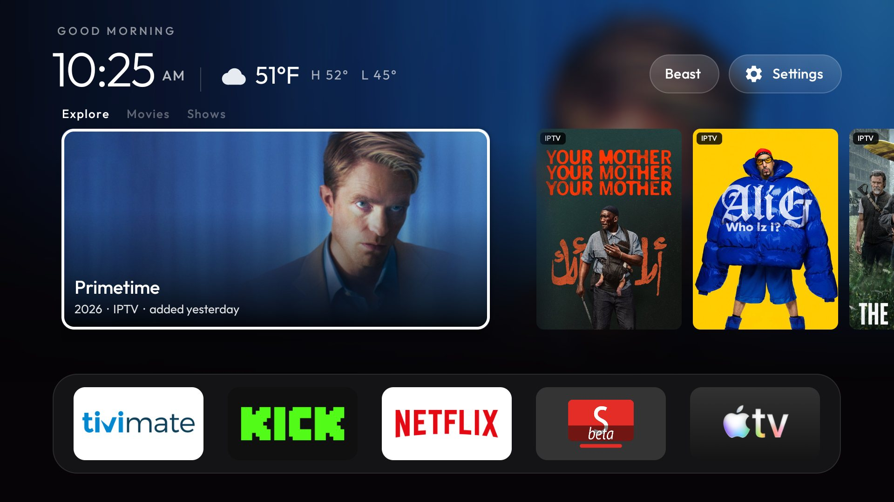

# MyTV

My home TVs, set up with a customised fork of [Clean Your TV](https://github.com/Gathin23/cleanyourtv): the
stock Google TV home is replaced by a clean Apple TV style launcher (`com.gathin.tvhome`), and tracking and
unused system services are disabled (never uninstalled). The original project's README is unchanged at [`README.md`](README.md).

This is a private, personal backup. Nothing here is meant for upstream.

## What I added on top of upstream

- **Movies & Shows rail** above the dock: a showcase with the selected title, a strip of the next posters, and
  Explore / Movies / Shows tabs. It merges my Beast (Mediarium) download library, played in mpv, with the IPTV
  provider's newest movies, played in Just Player. Downloads win over streams when both exist.
- **Auto-rotating spotlight** that cross-fades every 10 seconds when idle, also while the spotlight is focused.
  Any key press restarts the 10 seconds.
- **Wide TMDB backdrops** looked up on demand for the showcased title, and a crisper blurred home backdrop.
- **Beast button** in the top bar that opens the Mediarium panel full-screen (all three rooms).
- **Weather widget** in place of the date next to the clock: current temperature, a condition icon, today's
  high/low, from the TV's own location (all three rooms).
- **Per-room setups** under [`mytv/`](mytv/README.md): one config, debloat list and set of scripts per TV.
- A "Show more" browse screen with the downloaded library and TMDB trending titles that the IPTV provider carries.

## My TVs

| Room | Device | Rail |
|------|--------|------|
| Jeremys Office | Hisense SmartTV 4K (lushan), Google TV 12 | Movies & Shows, Beast button, Weather widget |
| LivingRoom TV | onn. Streaming Device 4K pro (SNA), Google TV 14 | Movies & Shows, Beast button, Weather widget |
| Master Bedroom | onn 4K Pro (jarvis2), Google TV 14 | Movies & Shows, Beast button, Weather widget |

Addresses, what was disabled and why, remote-button notes and the restore commands are in
[`mytv/README.md`](mytv/README.md). Each room's folder has its own `config.xml`, `debloat.txt` and the batches
as applied.

## Common tasks

Run from the repo root in PowerShell. The TV needs USB debugging and Network debugging switched on.

| To | Run |
|----|-----|
| Build the launcher for a room and install it | `pwsh mytv\build-and-install.ps1 -Room 'LivingRoom TV'` |
| Snapshot a TV before changing it | `pwsh mytv\backup.ps1 -Room 'LivingRoom TV'` |
| Undo a room's debloat and give Home back | `pwsh mytv\restore.ps1 -Room 'LivingRoom TV'` |
| Disable a batch of packages | `pwsh tools\disable.ps1 -TvHost <ip>:5555 'mytv\<room>\batch1.txt'` |
| Push the Christmas theme | `pwsh tools\theme.ps1 -TvHost <ip>:5555 themes\christmas` |
| Take a screenshot | `$env:TV_HOST='<ip>:5555'; .\.venv\Scripts\python.exe tools\tv.py --screenshot shots\x.png` |

Edit `mytv\<room>\config.xml`, not `launcher\app\src\main\res\values\config.xml`: the room's file is copied over
the launcher's on every build, so the launcher's copy always shows the last room built.

## Setting up a new TV like the office

1. Add the room to `mytv\rooms.ps1`, and to the `ValidateSet` in `build-and-install.ps1`, `backup.ps1` and
   `restore.ps1`.
2. Back it up first with `backup.ps1`. Check `dumpsys wifi | grep -o 'cname=[^ ]*'` before disabling the setup
   wizard: if it owns the saved Wi-Fi network, disabling it drops the TV off Wi-Fi.
3. Copy the office `config.xml` into the new room's folder and change what the hardware needs (a streaming box
   has no Live TV app or HDMI inputs). Keep the top bar to Beast and Settings: `show_network_pill` and
   `show_inputs_pill` stay `false` in every room.
4. Disable the debloat batches one at a time with a screenshot between them, setup wizard last.
5. Install mpv and Just Player if the room uses the rail, then run `build-and-install.ps1`.
6. Push the theme, reboot once, and compare `pm list packages -d` before and after.

## Build

JDK 17 and the Android SDK are set up by `mytv\toolchain.ps1` into `%LOCALAPPDATA%\cleanyourtv-toolchain`. The
release APK must stay under 786,432 bytes (the repo's size gate); the current build is about 627 KB.

## Not in this repo

These stay on my PC on purpose, so a fresh clone will not build the rail until they are recreated:

- `launcher\app\src\main\res\values\iptv_secrets.xml`, `beast_secrets.xml`, `tmdb_secrets.xml`: the IPTV
  login, the Beast server addresses and API key, and the TMDB API key. The exact files and what each value means
  are in [`mytv/README.md`](mytv/README.md#secrets-files-git-ignored-recreate-on-a-new-pc).
- `mytv\*\backups\`: package and settings snapshots of each TV, taken before any change.
- `mytv\Jeremys Office\beast_key.txt`: the Beast server API key.
- `tools\adbkey`: the ADB key that the TVs authorised.
- `shots\`: screenshots, which show the Wi-Fi name.

## Credit and licence

Built on Clean Your TV by Gathin23, released under the MIT licence; see [`LICENSE`](LICENSE) and
[`README.md`](README.md). The room setups, the Movies & Shows rail and the other changes above are my own
additions to the fork.
