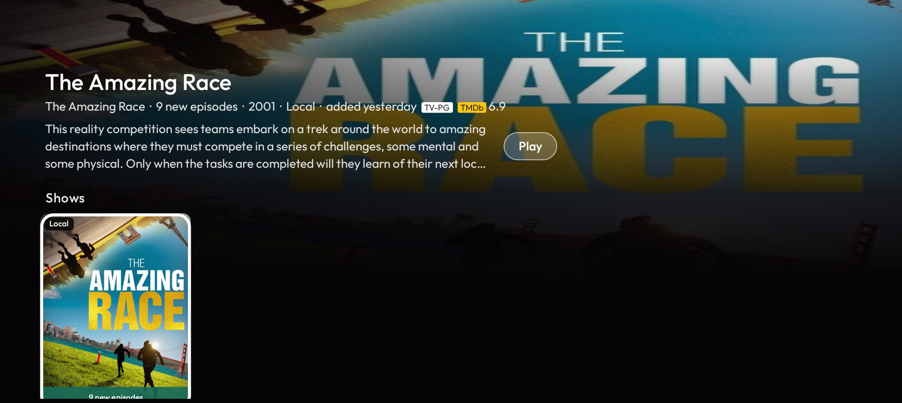
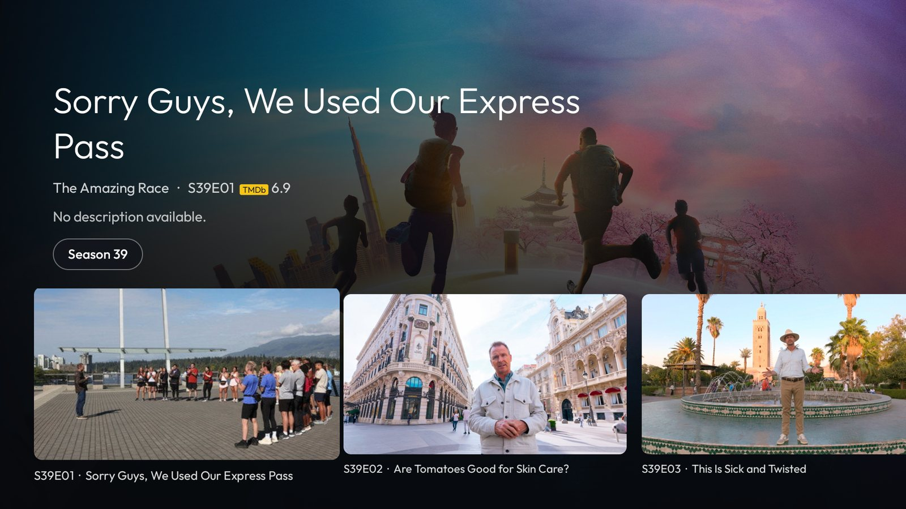

# MyTV

My three home TVs, running a customised fork of [Clean Your TV](https://github.com/Gathin23/cleanyourtv): the
stock Google TV home screen is replaced by a clean, Apple TV style launcher (`com.gathin.tvhome`), and the
tracking and unused system services are disabled (never uninstalled). This is a private, personal backup;
nothing here is meant for upstream. The original project's README is kept for reference at
[`README.upstream.md`](README.upstream.md).

## What I added on top of upstream

- **Cinematic Dashboard**: a full-screen TMDB backdrop with title, overview, year, runtime, US age rating and a
  yellow `TMDb` score badge. A focusable **Play** pill opens the presented title, while the only row below the
  spotlight is the configured priority-app dock.
- **Shows**: a separate rail and show-detail screen with the show's artwork, overview, seasons and episode cards.
  Selecting Shows focuses its first card and pauses the movie spotlight.
- **Auto-rotating movie spotlight**: Dashboard keeps the priority-app focus in place while the spotlight
  cross-fades every 10 seconds. If the Play pill is focused instead, focus returns to the first priority app after
  10 seconds. Movies is a separate poster rail with its own 10-second focus timeout.
- **Drawer navigation**: Back or the rail's left edge opens Dashboard, TV, Movies, Shows, Apps, Home Assist and
  Settings. The drawer highlights the current section and physical Home always returns to Dashboard.
- **Apps page**: a standalone catalogue using the launcher's original TV banner tiles, app order, focus scale and
  animation. Pressing Down from the Dashboard priority dock fades into this same catalogue; Up from its first row
  or Back restores the priority-app focus left behind. The drawer opens the same catalogue and keeps its existing
  drawer return behavior.
- **Home Assist**: opens from the drawer through the guarded WebView. The launcher no longer exposes a Mediarium
  web panel or polls Home Assistant for camera/motion alerts.
- **Series freshness**: a show moves up using its newest downloaded episode file's modification time, rather
  than the older date at which the series was first added.
- **Weather widget** in place of the date next to the clock: current temperature, a condition icon and today's
  high and low, from the TV's own location.
- **Per-room setups** under [`mytv/`](mytv/README.md): one config, debloat list and set of scripts per TV.

## What is Mediarium (Beast)?

"Beast" is my nickname for **[Mediarium](https://mediarium.app/)**, the self-hosted media server running on my
home network. It is still the source behind the Dashboard's Local movies and Shows, but it has no TV-facing
drawer destination or web panel. Nothing in it leaves the LAN.

What it does:

- **Keeps a download library.** Mediarium manages a library of downloaded movies and shows and serves the files
  over my home network. The launcher reads that library for the "Local" titles in the rail and plays them in mpv.
- **Feeds the rail alongside IPTV.** The Movies & Shows rail merges Mediarium's downloads with the newest movies
  from my IPTV provider (read over its Xtream Codes API). When the same title exists in both, the download wins.
  TMDB fills in the wide backdrops, logos, ratings and overviews.

How the pieces fit:

| Piece | Role |
|-------|------|
| Mediarium server ("Beast") | Self-hosted on the LAN: the download library and file server |
| Dashboard rails | Mediarium downloads (mpv) + IPTV newest movies (Just Player), deduped, art from TMDB |
| Apps page | Original CleanYourTV banner tiles in a standalone catalogue |

The server addresses, the IPTV login and the TMDB key are **not** in this repo: they live in git-ignored
`*_secrets.xml` files that a fresh clone recreates locally. See
[`mytv/README.md`](mytv/README.md#secrets-files-git-ignored-recreate-on-a-new-pc) for the exact files.

### Dashboard, Shows and the Apps page

The side drawer replaces the old Home / Explore tabs:

- **Dashboard** rotates the newest Local and IPTV movie spotlight over the full-screen backdrop while the
  configured priority apps stay in the bottom dock. App focus does not pause or affect the spotlight. Up from the
  apps focuses the **Play** pill, which opens the current title; if Play stays focused for 10 seconds, focus returns
  to the first priority app. Down from an app fades into the full Apps catalogue. Up from its first row or Back
  restores the priority app where the transition began.
- **Movies** is separate from Dashboard and keeps the Recently Added poster rail. It enters with the first card
  focused. After 10 seconds of inactivity, focus clears and the spotlight resumes rotating; the next D-pad key
  restores movie focus.
- **Shows** uses downloaded series and focuses the first card after the rail switch. It pauses the movie rotation.
  OK opens the show's season/episode page; Back returns to the previous screen.
- **Apps** opens a separate catalogue rendered with the original launcher `AppAdapter` tiles and banner artwork.
  Its ordering is the launcher's configured ordering, not a new app sort.
- **Home Assist** opens the configured Home Assistant dashboard. The launcher does not monitor cameras or show
  motion alerts.
- The full-screen backdrop, episode title, show title, year, runtime, age rating, `TMDb` score and overview follow
  the focused item.
- **Age ratings** come from TMDB's US listing and appear next to the year, both here and on the Home showcase.
  Movies show their certificate (PG-13, R and so on) and series show their TV rating (TV-14, TV-MA and so on). A title with no US release on TMDB shows no age rating, so an unreleased film stays
  blank until TMDB lists one.

The same banner tiles appear in the full Apps catalogue:

Focusing a show opens its episodes in order as wide stills, each with its own TMDB name and overview:

## My TVs

| Room | Device | Features |
|------|--------|------|
| Office | Hisense SmartTV 4K (lushan), Google TV 12 | Dashboard, Shows detail, Apps catalogue, drawer, Weather widget |
| LivingRoom TV | onn. Streaming Device 4K pro (SNA), Google TV 14 | Same launcher features, Weather widget |
| Master Bedroom | onn 4K Pro (jarvis2), Google TV 14 | Same launcher features, Weather widget |

Addresses, what was disabled and why, remote-button notes and the restore commands are in
[`mytv/README.md`](mytv/README.md). Each room's folder has its own `config.xml`, `debloat.txt` and the batches
as applied.

## Common tasks

Run from the repo root in PowerShell. The TV needs network ADB enabled. If it only offers Wireless debugging,
pair with platform-tools `adb` and use the connection endpoint shown in Developer options; see the
[native ADB guide](tools/native-adb.md).

| To | Run |
|----|-----|
| Build the launcher for a room and install it | `pwsh mytv\build-and-install.ps1 -Room 'LivingRoom TV'` |
| Snapshot a TV before changing it | `pwsh mytv\backup.ps1 -Room 'LivingRoom TV'` |
| Undo a room's debloat and give Home back | `pwsh mytv\restore.ps1 -Room 'LivingRoom TV'` |
| Disable a batch of packages | `pwsh tools\disable.ps1 -TvHost <ip>:5555 'mytv\<room>\batch1.txt'` |
| Push the Christmas theme | `pwsh tools\theme.ps1 -TvHost <ip>:5555 themes\christmas` |
| Take a screenshot | `$env:TV_HOST='<ip>:5555'; .\.venv\Scripts\python.exe tools\tv.py --screenshot shots\x.png` |

Edit `mytv\<room>\config.xml`, not `launcher\app\src\main\res\values\config.xml`: the room's file is copied over
the launcher's on every build, so the launcher's copy always shows the last room built.

## Setting up a new TV like the office

1. Add the room to `mytv\rooms.ps1`, and to the `ValidateSet` in `build-and-install.ps1`, `backup.ps1` and
   `restore.ps1`.
2. Back it up first with `backup.ps1`. Check `dumpsys wifi | grep -o 'cname=[^ ]*'` before disabling the setup
   wizard: if it owns the saved Wi-Fi network, disabling it drops the TV off Wi-Fi.
3. Copy the office `config.xml` into the new room's folder and change what the hardware needs (a streaming box
   has no Live TV app or HDMI inputs). The main navigation is now in the side drawer, without TV-facing
   Mediarium or camera-alert controls. Keep `weather_widget`, `explore_page` and `media_rail` on.
4. Disable the debloat batches one at a time with a screenshot between them, setup wizard last.
5. Install mpv and Just Player if the room uses the rail, then run `build-and-install.ps1`.
6. Push the theme, reboot once, and compare `pm list packages -d` before and after.

## Build

JDK 17 and the Android SDK are set up by `mytv\toolchain.ps1` into `%LOCALAPPDATA%\cleanyourtv-toolchain`. The
release APK must stay under 786,432 bytes (768 KiB); the current local build is about 640 KiB.

## Not in this repo

These stay on my PC on purpose, so a fresh clone will not build the rail until they are recreated:

- `launcher\app\src\main\res\values\iptv_secrets.xml`, `beast_secrets.xml`, `tmdb_secrets.xml`: the IPTV login,
  the Mediarium server addresses and API key, and the TMDB API key. The exact files and what each value means are
  in [`mytv/README.md`](mytv/README.md#secrets-files-git-ignored-recreate-on-a-new-pc).
- `mytv\*\backups\`: package and settings snapshots of each TV, taken before any change.
- `mytv\Office\beast_key.txt`: the Beast server API key.
- `tools\adbkey`: the ADB key that the TVs authorised.
- `shots\`: screenshots, which show the Wi-Fi name.

## Credit and licence

Built on Clean Your TV by Gathin23, released under the MIT licence; see [`LICENSE`](LICENSE) and the original
page at [`README.upstream.md`](README.upstream.md). The room setups, the Movies & Shows rail, the Explore page
and the other changes above are my own additions to the fork.
