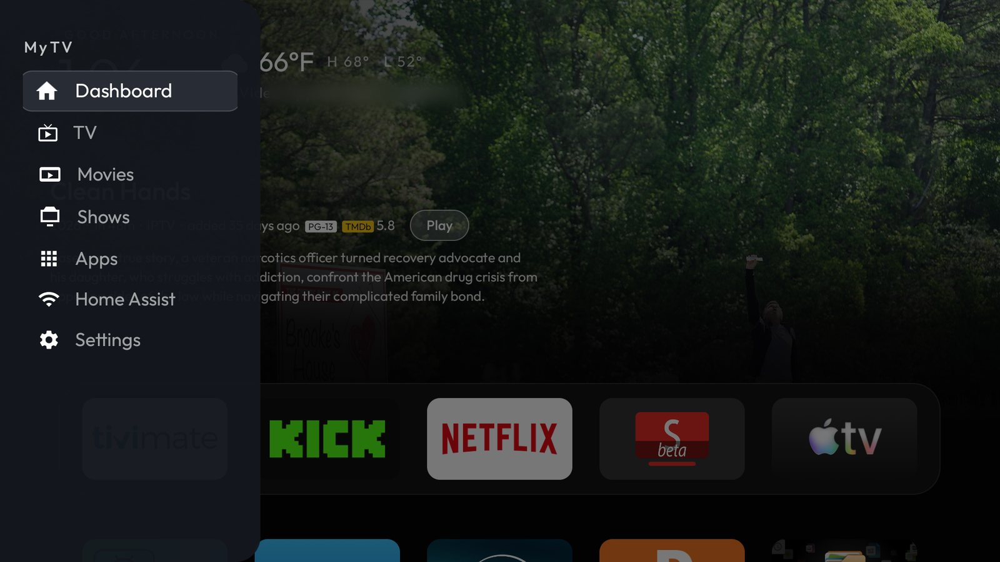
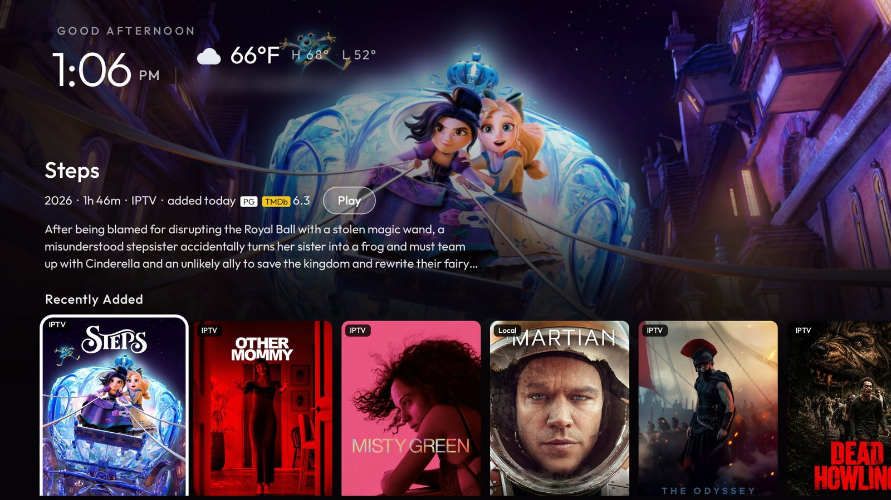
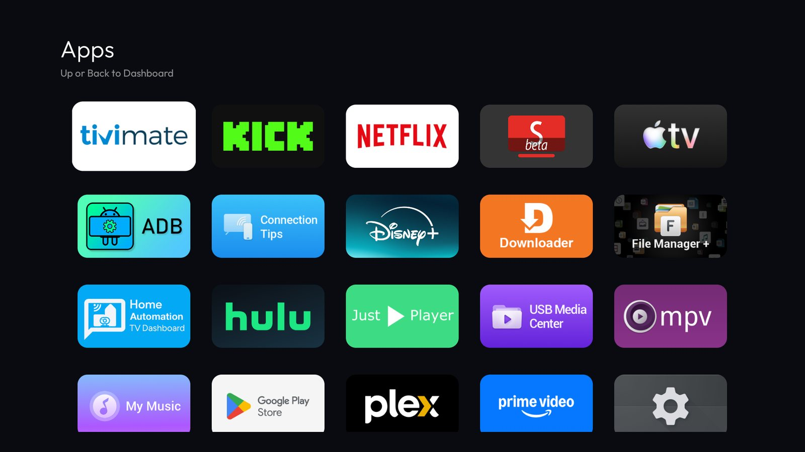

# MyTV

A cinematic, Apple TV–style home screen for the Google TV devices in my house. It is built on a private fork
of [Clean Your TV](https://github.com/Gathin23/cleanyourtv). The stock Google TV home and its ads are replaced
by a fast, quiet launcher (`com.gathin.tvhome`). The tracking and unused system services are disabled, never
uninstalled, so every change can be undone.

## Highlights

- **Dashboard first.** Every press of Home opens a full-screen backdrop of the newest movie, with its title,
  year, runtime, age rating and TMDb score. Your favorite apps sit in a dock underneath.
- **Movies and Shows** each have their own poster rail. Shows opens a full episode guide with stills and titles.
- **One side drawer** handles all navigation: Dashboard, TV, Movies, Shows, Apps, Home Assist and Settings.
- **Every app is one press away.** Press Down from the dock and the screen fades into the full app catalog.
- **Weather and your next calendar event** sit next to the clock.
- **Light and private.** There is no telemetry and no background polling, and the release APK is under 700 KB.

## A quick tour

### Dashboard

The spotlight changes to a new movie every 10 seconds, while focus stays on your apps. Press **Up** to reach
**Play**, which starts the title on screen. Leave Play focused for 10 seconds and focus returns to the first app.

### The side drawer

Press **Back**, or **Left** from the edge of a row, to slide the drawer open. It highlights the section you are
in. Pressing **Home** closes it and goes back to the Dashboard.

### Movies

Movies opens with the first poster selected. The backdrop and details follow whichever poster you are on. After
10 seconds without a key press, the selection clears and the spotlight starts changing again. Any arrow key brings
the selection back.

### Shows

Shows lists your downloaded series, newest episode first, so a show with a new episode comes back to the front.
Press OK on a show to open its episode guide. Each episode has its own still, title, overview and TMDb score.

### Apps

Press **Down** from the dock and the screen fades into the full catalog. It uses the same tiles and order as
the dock. Press **Up** from the top row, or **Back**, to return to the exact app you left.

### Metadata

Backdrops, overviews, US age ratings (PG-13, R, TV-14 and so on) and the yellow `TMDb` score come from
[TMDB](https://www.themoviedb.org/). A title with no US release on TMDB shows no rating.

## Remote cheat sheet

| Press | On | Does |
|-------|----|------|
| Home | Anywhere | Back to the Dashboard, with the first app selected |
| Back, or Left at the edge | Dashboard, Movies, Shows | Opens the side drawer |
| Up | Dashboard dock | Selects **Play** for the spotlight movie |
| Down | Dashboard dock | Fades into the full app catalog |
| Up or Back | Top row of the app catalog | Returns to the Dashboard app you came from |
| OK | A movie or show | Plays the movie, or opens the show's episode guide |

## My TVs

| Room | Device | Notes |
|------|--------|-------|
| Office | Hisense 4K Smart TV (lushan), Google TV 12 | Built-in TV, so HDMI inputs and a Live TV app |
| Living Room | onn 4K Pro streaming box, Google TV 14 | Streaming box only |
| Master Bedroom | onn 4K Pro (jarvis2), Google TV 14 | Streaming box only. A sixth column of apps |

All three run the same launcher, built with each room's own `config.xml`. What was disabled and why, the
remote-button notes and the restore commands for each room are in [`mytv/README.md`](mytv/README.md).

## Common tasks

Run these from the repo root in PowerShell. The TV needs network ADB turned on. If it only offers Wireless
debugging, pair with platform-tools `adb` first; see the [native ADB guide](tools/native-adb.md).

| To | Run |
|----|-----|
| Build the launcher for a room and install it | `pwsh mytv\build-and-install.ps1 -Room 'LivingRoom TV'` |
| Back up a TV before changing it | `pwsh mytv\backup.ps1 -Room 'LivingRoom TV'` |
| Undo a room's debloat and give Home back | `pwsh mytv\restore.ps1 -Room 'LivingRoom TV'` |
| Disable a batch of packages | `pwsh tools\disable.ps1 -TvHost <ip>:5555 'mytv\<room>\batch1.txt'` |
| Push the Christmas theme | `pwsh tools\theme.ps1 -TvHost <ip>:5555 themes\christmas` |
| Take a screenshot | `$env:TV_HOST='<ip>:5555'; .\.venv\Scripts\python.exe tools\tv.py --screenshot shots\x.png` |

Edit `mytv\<room>\config.xml`, not `launcher\app\src\main\res\values\config.xml`. Every build copies the room's
file over the launcher's, so the launcher's copy always matches the last room built.

## Setting up a new TV

1. Add the room to `mytv\rooms.ps1`, and to the `ValidateSet` in `build-and-install.ps1`, `backup.ps1` and
   `restore.ps1`.
2. Back the TV up with `backup.ps1`. Before disabling the setup wizard, check
   `dumpsys wifi | grep -o 'cname=[^ ]*'`. If the wizard owns the saved Wi-Fi network, disabling it takes the TV
   off Wi-Fi.
3. Copy the Office `config.xml` into the new room's folder and change what the hardware needs. A streaming box
   has no Live TV app or HDMI inputs. Keep `media_rail`, `explore_page` and `weather_widget` on.
4. Disable the debloat batches one at a time, with a screenshot between them. Disable the setup wizard last.
5. Install mpv and Just Player, which play the movies and episodes, then run `build-and-install.ps1`.
6. Push the theme, reboot once, and compare `pm list packages -d` before and after.

## Build

`mytv\toolchain.ps1` sets up JDK 17 and the Android SDK in `%LOCALAPPDATA%\cleanyourtv-toolchain`. The release
APK must stay under 786,432 bytes (768 KiB). The current build is about 650 KiB.

## Not in this repo

Private provider logins, media-server credentials, API keys and device details are kept on my PC on purpose:

- `mytv\*\backups\`: package and settings snapshots of each TV, taken before any change.
- `tools\adbkey`: the ADB key the TVs have authorized.
- `shots\`: raw screenshots, which can show personal details.

## Credit and license

Built on [Clean Your TV](https://github.com/Gathin23/cleanyourtv) by Gathin23, released under the MIT license.
See [`LICENSE`](LICENSE). The upstream README is kept at [`README.upstream.md`](README.upstream.md). The
Dashboard, drawer, Movies and Shows rails, the episode guide, the Apps catalog and the room setups are my own
additions to the fork.
